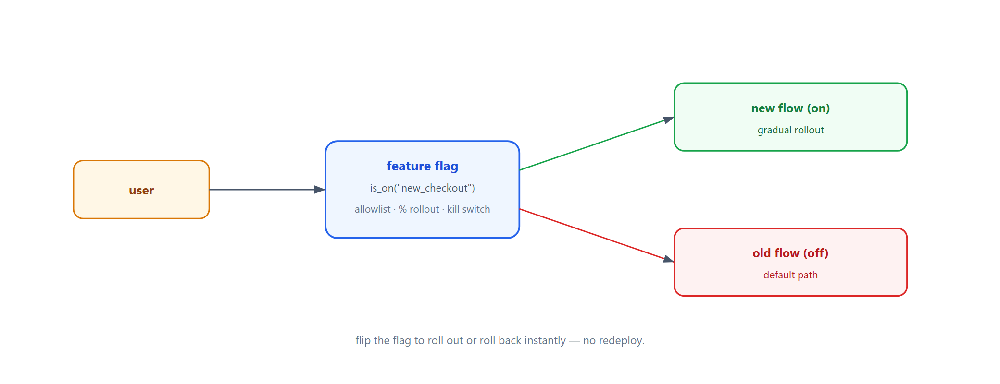
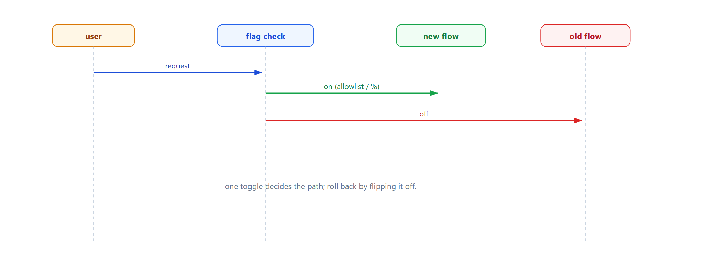

# Learn Feature Flag — Gradual Rollout with Toggles

> **Learning / study repo. Self-contained demo, NOT production code.**
> New features ship behind a flag. Roll out to an allowlist first, then a percentage of users,
> then everyone — without redeploying. Turn the flag off to instantly roll back.

## The idea

```
  if flags.is_on("new_checkout", user):
      new_checkout(user)   # new flow
  else:
      old_checkout(user)   # old flow
```

- **Allowlist** — enable for specific users first.
- **Percentage rollout** — hash-based, consistent per user.
- **Kill switch** — flip the flag off to roll back instantly.



## Why this matters

- **Safe rollout** — new code reaches real users gradually.
- **Instant rollback** — no redeploy to disable a bad release.
- **Separate deploy from release** — ship code dark, turn it on later.

## Run

```bash
python run_all.py
```

Pure Python standard library.

## Demo cases

1. **Flag off** — everyone gets the old flow.
2. **Allowlist** — only alice gets the new flow.
3. **50% rollout** — half the users (hash-based) get the new flow.

## Flow



## Sibling repos

- `learn_strangler_fig` — gradual traffic migration.
- `learn_bff_gateway` — where flags can gate responses.
- `learn_circuit_breaker` — another form of automatic safety.
